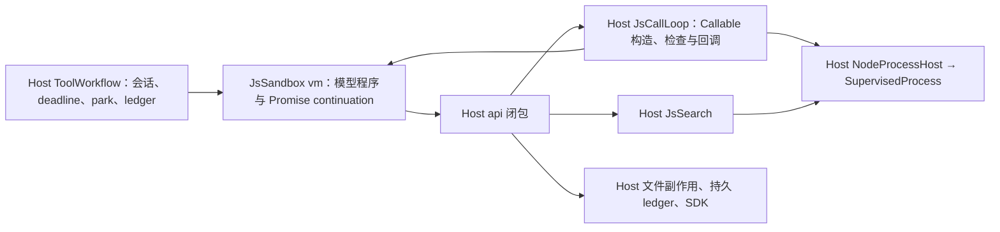

# MF-01：JS sandbox 物理 owner 接收前合同

日期：2026-10-21。此文是独立只读调查与下一包施工边界，不是实现完成或接收通过证明。

主仓：`/Users/yuanxi/.codex/worktrees/upstream-plan-20261020/vibe-fs`。
隔离 sandbox 候选：`/private/tmp/wanxiangli-module-sandbox-20261021`。

本轮未修改主仓源码、未编译、未重跑既有 20/18 测试集合。只在 `/private/tmp` 做新的最窄原语实验。暂不启动完整物理隔离实现；同步双通道、物理 park 与 Host 权威尚须落实合同及组合证明，不能提交不承接现有同步 API、闭包和 continuation 的简化版本。

## 1. 结论及证据范围

Bun 的 vm 异步期限缺口仍未解决。本轮没有找到比物理隔离更窄、且经过实际验证的 Bun vm 原生能力。

建议下一包先在隔离候选研究单程序、单子进程 owner，暂不接主仓。这个方向已有目标终止及 POSIX 暂停/恢复原语证据，但尚无完整双向 API、Callable、park、期限及副作用组合证明。

Worker 的同步共享内存回执及原生 terminate 已通过 Node/Bun 微型实验，但没有保留 continuation 的物理暂停证据。因此不能仅凭该实验选择 Worker 承接长期 park，也不能将候选的 `pause()` 当作物理停转证明。

## 2. 当前实际调用链

这些 realm 目前共用 Host 的执行线程。vm 上下文不是独立物理 owner。

- `src/Wanxiangshu/Process/JsSandbox.fs:126`：顶层 async IIFE 包装与 API proxy；每次 API 调用检查可变 deadline，但模型可以在不再调用 API 的异步 continuation 中循环。
- `JsSandbox.fs:258`：将真实 api 和共享 park 状态注入 vm。`JsRunHandle` 保有原 Promise、deadline 引用、API、借用/重置闭包及 park 状态。
- `JsSandbox.fs:406`：park 信号与 deferred Promise；unpark resolve，abandon reject，以原 JS continuation 运行 finally。
- `src/Wanxiangshu/Repository/Programming/Js/OpenCode/ToolWorkflow.fs:653`：构造 Host 执行 scope；`ReadOutput`、`Own` 和取消能力来自真实 process host。
- `ToolWorkflow.fs:692`：借用原 run 的 deadline；不是创建第二个期限权威。
- `ToolWorkflow.fs:728`：Host 持有 park 状态，并在程序运行前安装 park 信号。
- `ToolWorkflow.fs:772`：程序 Promise 结算后结算 ledger、移除 parked site、取消和释放生命周期。
- `ToolWorkflow.fs:947`：unpark 继续原 run，更新期限并安装新 park 信号；重新 park 产生新 site。
- `ToolWorkflow.fs:1030`：abandon 先取消进程 scope、拒绝 park deferred，再重置清理期限，等待原程序 finally 与 ledger。
- `src/Wanxiangshu/Repository/Programming/Js/ToolsBindings.fs:165`：write 是同步调用；真实落盘及 Prepared/Committed append 发起由 Host 闭包完成，pending append 最终由 ledger 结算。rm/mv 等同样不能统一改成必须 await。
- `src/Wanxiangshu/Repository/Programming/Js/Description.fs:456`：生成的 `write` 方法同步调用 `_api.write`。现有 requirement 程序包含不加 await 的 `this.write(...)`，不是可删除的便利行为。
- `ToolsBindings.fs:781`：`JsCallHost.Loop` 接收模型 class 对象；`makeCallMember` 把该对象交给 Host loop。
- `src/Wanxiangshu/Process/JsCallLoop.fs:828`：实际构造 Callable，读取可能是 getter 的元数据与方法。
- `JsCallLoop.fs:1740`：sanity 返回 `nextDone/watchVeto` 函数，随后调用这些 thunk 和模型方法。
- `JsCallLoop.fs:1862`：证明与真实执行使用不同实例，不能把证明阶段的可变状态带入运行。
- `JsCallLoop.fs:1112`：向 watch 暴露输出前重新授权；`next/watch/onExit` 可返回 Promise。
- `JsCallLoop.fs:1596`：Host Own 管理真实进程工作；期限触发时停止并排空子资源，不能只返回超时值。
- `src/Wanxiangshu/Process/JsSearch.fs:113`、`:202`：实际检查 ReadOutput、剩余时间与取消；未知关闭继续保有 owner。
- `src/Wanxiangshu/OpenCode/Tools/ToolRegistry.fs:755`：生产 `ReadOutput` 调用会话恢复后的权威检查，Own 使用 runtime 的 RunOwnedProcess；不能替换成独立测试 Surface 的许可默认值。

隔离候选 `src/sandbox/Sandbox.fs` 的膜用 WeakMap 保留跨 realm 身份、转接 Promise，并用 `bridgeInstance/unwrap` 回调模型实例。候选的 `hostValues.invoke` 和 vm pump 改善同步回调边界，但不能单靠这些机制证明所有 after-await continuation 都受原生期限限制。已知 Host 异步调用 Callable.next 的反例说明仅移动顶层 run 不够。

## 3. 最小隔离合同

### 3.1 一个模型 run 对应一个物理 owner

所有模型可执行内容必须始终留在该 owner：顶层 run、构造器、getter、sanity thunk、next/watch/onExit、Promise continuation，以及序列化会触发的 thenable/toJSON。Host 不接收可执行模型函数，不通过函数源码重建闭包。

Host 继续持有 JsCallLoop、JsSearch、真实 shell/rg owner、文件/SDK 能力、ledger 和会话权威。这样停止模型 owner 不会让它自己持有的独立 shell 进程组失去清理者。

每个请求、class/instance/thunk 句柄和结果须绑定本次 run 的不可混淆身份。关闭后拒绝迟到消息，不能给新 run 重用旧句柄。

### 3.2 同步 API 与异步 API 分开承接

同步 write/rm/mv 等必须保持调用返回顺序、现有错误及副作用行为；不能强迫旧程序补 await。Host 侧继续调用原能力闭包，不将实际落盘和 journal 权威迁到 guest。

仅使用一个普通异步 stdin reader，再由同步 API 对同一字节流 readSync，存在争读风险。下一包必须实现并证明独立同步回执通道，或另一个明确、可验证的双通道协议。不得同步阻塞 Host 主线程。

原语实验只证明顺序的小数据请求。它没有证明并发 callback、任意既有输出大小、Unicode、背压及失败清理。传输分块上限不能偷偷成为新的产品返回值上限。

`Written` 只确认第一跳管道写入；还须有绑定请求的业务回执。写入已被 Host 接受而回执丢失时，不能自动重发。

异步 API 在 owner 内返回本地 Promise，通过请求 ID 对应 resolve/reject；不跨边界直接传递 Promise 对象。保留 JsFailure 与现有 sentinel 语义。

### 3.3 Callable 使用显式异步句柄端口

Host 只拿 class/instance/thunk 句柄与已验证数据，通过端口完成构造、读取和调用。元数据 getter、属性检查和序列化也不能在 Host 执行模型代码。

保留当前 sanity 协议、receiver/闭包语义、证明与执行分用实例、异步 next/watch/onExit 和背景进程控制。同步构造/读取路径需要先改成明确的异步端口，不能藏在返回原对象的 Proxy 后继续执行。

### 3.4 park 与生命周期

至少区分 Active、ParkRequested、Parked、Abandoning、Closing、Closed。请求 park 不等于已物理暂停。

park 可跨工具调用长期保留 continuation。单纯暂停 watchdog 会漏掉 park 后遗留的恶意微任务；一直运行原 wall-clock deadline 又会杀掉正常长期 park。候选的 Host pump pause 不能替代物理停转证据。

如果选子进程，暂停/恢复应成为其真实 owner 的明确能力，并观察暂停/恢复状态；不能把信号 Requested 当作已暂停。当前 ProcessSession 公共 SignalName 不含 SIGSTOP/SIGCONT，本轮 Raw POSIX probe 不等于该接口已经存在。

unpark 须把新期限、park 代次和注入值按一个明确顺序交接，再允许模型继续。目标暂停时，大消息不能因等待其消费而死锁；第一跳写入回执也不等于原 Promise 已恢复。

abandon 保留原等待的 reject 和 finally 清理窗口。到界后由外部 owner 强制终止；Host 仍须结算已开始的 ledger 和真实子资源。不能因模型 owner 已死而丢掉已发生的文件写入，也不能假报 finally 已完成。

### 3.5 deadline 只有一个权威

Host 持有 deadline、并行 lease、幂等释放及 reset 的权威；传输只携带快照或代次。保留当前 BorrowDeadline 的剩余预算恢复，以及借用期间 reset。

`JsCallLoop` 当前为证明和执行借用 `2 * min(maxDuration, HardLimit) + 2 * signalGrace`。不能用一个新的固定短超时替代，导致合法 shell 等待吃掉模型原本的剩余预算。

物理终止定时器必须处在模型 owner 之外。返回 PROGRAM_TIMEOUT 之前需要真实终结证据；终结未知不能伪装为已回收。

### 3.6 Host 权威与副作用

保留每项现有能力各自的检查，不用一条通用 RPC 许可替代业务门禁。尤其 ReadOutput 必须在实际输出窗口检查，不能缓存最初工具准入，或接受 guest 声称已经授权。

模型只能收到已经授权的输出切片，不能获得 ProcessSession、SDK、ledger 或真实 Host 函数。模型 owner 终结后，拒绝后续请求；已接受的操作仍由 Host 结算。接受后回执未知不是重试许可。

## 4. 已有接口：可复用与缺口

| 接口 | 可复用 | 不提供的证明 |
| --- | --- | --- |
| ProcessSession Capture | 目标启动、双路字节流、背压、stdin 写入、原生 exit/close、等待及丢弃 | Callable/RPC 权威、业务消费回执、暂停/恢复、任意脱离组的后代回收、安全沙箱 |
| SupervisedProcess | 现有 Host shell/rg 组监管、完整 Capture、排空与故障事实 | 硬 KILL 后必有精确目标退出回执；本轮实际得到 UNKNOWN_TARGET_EXIT |
| JsCallLoop ExecutionScope | Cancellation、Own、ReadOutput、HardLimit、剩余时间、deadline 借用 | 跨进程 Callable 身份与回调调用协议 |
| ToolWorkflow | 会话/park site、ledger 结算、unpark/abandon、文件访问观察及交付门禁 | 子 owner 停止、物理暂停及双通道传输 |
| 隔离 sandbox 膜 | realm 内能力包装、身份与错误转接的现有工作 | 物理 CPU 停转、完整 Host 能力接收及全部异步期限证书 |

## 5. 本轮原语实验：历史证据，不是接收绿证

1. **ProcessSession 顺序同步回执与 after-await 终止：通过。**
   - `/private/tmp/vibe-fs-mf01-sync-transport-probe.mjs`
   - `/private/tmp/vibe-fs-mf01-sync-transport-probe.log`
   - Node 22.13.0 / Bun 1.3.14 目标各在同步 Host write→read 后观察到实际文件内容，再 await 后进入死循环。外部定时器终止目标，取得 SIGKILL、Closed、failure=null，分别约 244/229ms。
   - 只证明顺序小数据原语，没有双向并发 RPC 或主仓能力组合证明。

2. **Worker 共享内存同步回执与原生终止：通过。**
   - `/private/tmp/vibe-fs-mf01-worker-transport-probe.mjs`
   - `/private/tmp/vibe-fs-mf01-worker-transport-probe.log`
   - Node 22.13.0 / Bun 1.3.14 内 Callable.next 完成实际 Host 同步 write/read；await 后死循环。父线程仍响应，await terminate 及独立 exit，分别约 214/216ms，外部 3s 兜底未触发。
   - 没有 vm 膜、长期 park 的物理暂停及完整 API/Callable/ledger 证明。

3. **POSIX 进程暂停/恢复并保留 continuation：通过。**
   - `/private/tmp/vibe-fs-mf01-park-owner-probe.mjs`
   - `/private/tmp/vibe-fs-mf01-park-owner-probe.log`
   - Node/Bun 目标 SIGSTOP 后经 ps 观察 T；排入 resume 后 SIGCONT，原闭包值 41→42，native exit 0，目标 PID 已不存在。
   - 使用父端 Raw POSIX signal；不代表 ProcessSession 已公开该能力，也没有完整 park/RPC 原子交接证明。

4. **Supervision 硬 KILL 精确退出假设：失败，必须保留。**
   - `/private/tmp/vibe-fs-mf01-supervision-target-exit-failed.log`
   - 硬 KILL 后 Closed.failure 为 UNKNOWN_TARGET_EXIT；没有将 Unknown 改判为成功。该事实与库的公开边界一致。

微型 probe 的初次输入曾直接传 process.env，因它不是 plain data object 被库拒绝；随后用 plain env 拷贝运行。输入拒绝没有算作目标执行证明。

以上实验只在临时目录写入数据，未改主仓、未构建。保留证据后停止重复运行。

## 6. 下一包施工范围与接收门槛

先在隔离候选明确 owner/暂停/RPC/Callable 契约，验证双向并发及清理，再决定主仓接线。预计接线边界涉及：

- 库 sandbox 实现、声明及私有 worker/owner 入口；ProcessSession 的暂停/恢复能力若确有必要，须单独给合同和原生证据。
- 主仓 `Process/JsSandbox.fs/.fsi` 的 run owner 与生命周期。
- `Process/JsCallLoop.fs/.fsi` 的显式 Callable 端口；清除直接 guest constructor/getter/callback 执行路径。
- `Repository/Programming/Js/ToolsBindings.fs/.fsi` 的 call 交接，以及 `OpenCode/ToolWorkflow.fs/.fsi` 的 park、期限、ledger 与关闭组合。
- JsSearch、ReadOutput、NodeProcessHost 和 SDK 能力保留 Host owner；只调整确有必要的传递点。

实施前先定契约和反例，不以现有 20/18 数量替代以下新组合证据：

1. 顶层同步循环、after-await 循环，以及 Host 调用 constructor/getter/sanity/thunk/next/watch/onExit 的异步循环，都不能阻塞主 Host；终止后资源真实关闭。
2. 同步不 await 的 write 后立即读取看到同一结果；大 Unicode 数据、背压和并发 callback 不争读通道、不新增产品限制。
3. 正常长期 park、unpark 值、再次 park、原闭包和 source marker 保留；park 后遗留失控 continuation 不能因关闭 watchdog 而无限运行。
4. abandon finally 在有限清理窗口执行；finally 失控后强制终止，已发生副作用仍由 Host ledger 结算。
5. 并行 deadline lease、不同释放顺序、借用期间 reset，以及合法长 shell 等待均保留。
6. 真实 ReadOutput 撤权后不再披露新输出；取消、retirement 和关闭不被迟到 RPC 重新打开。
7. Host 已接受、guest 未观察到回执的操作保持未知，不重复执行；旧 run 的 class/instance/thunk/lease 句柄不能控制新 run。
8. 正常返回、错误、超时与关闭失败分清；target/owner 的退出和输出收尾证据不互相冒充。

这些门槛目前未全部实现或验证。MF-01 保持未接收。
